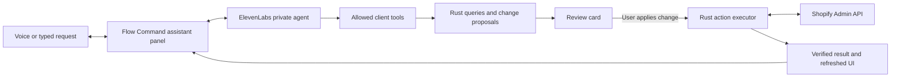

# Voice assistant proposal

Researched September 16, 2026. Scope: an assistant inside Flow Command that carries out inventory and order tasks. This is a proposed implementation, not a completed integration. No ElevenLabs account, microphone, or live write was tested during this investigation.

Recommend ElevenLabs Agents for conversation and voice, with a small, explicit set of Flow Command actions executed through Rust. The first release should complete real inventory adjustments and order notes/tags, alongside searching and navigating. More involved order operations can follow once their workflows exist.

ElevenLabs supports custom/cloned agent voices and handles transcription, turn taking, interruptions, and tool calls. Existing library voices can be referenced by ID; the user's particular voices and model compatibility still need to be checked in their workspace. [Voice agent capabilities](https://join.elevenlabs.io/api/conversational-ai), [voice library API support](https://elevenlabs.io/api).

**How it would feel**

A Talk button in the existing top bar opens a persistent assistant panel. The panel shows the active store, transcript, microphone state, and any proposed change. Start, mute, and end controls stay visible, and typing uses the same assistant. Changing pages keeps the conversation open. Starting a session is an explicit action.

Example: “Remove two units of this variant from retail inventory; they were damaged.” The assistant resolves the exact variant and location, then presents a review card with the store, SKU, quantity type, current count, adjustment, projected count, and reason. The user applies the reviewed change; the app executes it, refreshes inventory, and the assistant reports the actual result. Ambiguous locations, units, or products trigger a targeted clarification.

Example: “Add a note to order 1234 that we need to check the packing slip.” The assistant finds the order in the specified store, shows the proposed note alongside the existing note, and applies it after review. A request to flag an order can add a tag; a tag must never be described as an actual fulfillment hold.

**What the repository already provides**

| Existing piece | Reuse and remaining work |
| --- | --- |
| React 19, Tauri 2, Rust HTTP client | Suitable places for conversation UI, token acquisition, and Shopify execution. No extra local server is needed for this design. |
| Global layout, store context, routing | Mount the assistant in `Layout`; pass current page/store/selected record as context. |
| Keychain-backed OpenRouter settings | Reuse the status/save/remove pattern for an ElevenLabs key. OpenRouter currently extracts COA PDFs; it is not a general assistant engine. |
| Live orders, products, inventory, customers, analytics, COAs | Reuse query logic through bounded assistant tools with explicit store identifiers. |
| Orders and inventory commands | These currently read data. Stock mutations and order management mutations need implementation. |
| Inventory records | Currently expose variant IDs and location names, but not the inventory-item and location IDs needed for writes. Location reads are also limited to the first three locations. Add exact write-target resolution. |
| Home and FGINV samples | Some Home values, FGINV inventory, and drift displays are sample data. Assistant tools must use live services and expose incomplete results. |

Code anchors: [layout](/Users/chase/Documents/Dev/Projects/flow-command/src/components/Layout.tsx:24), [store context](/Users/chase/Documents/Dev/Projects/flow-command/src/lib/app.tsx:8), [orders commands](/Users/chase/Documents/Dev/Projects/flow-command/src-tauri/src/lib.rs:699), [inventory query](/Users/chase/Documents/Dev/Projects/flow-command/src-tauri/src/lib.rs:902), [Keychain settings pattern](/Users/chase/Documents/Dev/Projects/flow-command/src-tauri/src/lib.rs:2572).

**Proposed connection and execution flow**

Use `@elevenlabs/react` with a private agent. The SDK supports WebRTC voice sessions, authenticated conversation tokens, transcripts, typed input, and contextual updates. Rust acquires the session credential using the Keychain key and returns only that credential to React. WebSocket sessions use a signed URL instead. Pin the SDK version when implementing and follow its current provider/hook API. [React SDK](https://elevenlabs.io/docs/eleven-agents/libraries/react).

Client tools run inside the app, allowing local access to its existing backend. Configure result-bearing tools to wait for their response so the agent can distinguish a successful lookup, a pending proposal, and an error. [Client tools](https://elevenlabs.io/docs/eleven-agents/customization/tools/client-tools).

The agent gets named tools such as `find_orders`, `get_inventory`, `open_record`, and `propose_inventory_adjustment`. It does not get arbitrary Tauri invocation or arbitrary GraphQL. Proposed changes receive an app-generated identifier. Applying that identifier is a separate UI action handled by Rust; the agent cannot manufacture approval through a tool argument. Return a proposal promptly instead of holding a tool request open while the user reviews it. After execution, surface the result in the panel and notify the conversation so it can report completion.

For this internal desktop design, credentials stay on the Mac and authenticated requests execute there. Audio, transcripts, and the minimal tool results required for a request are processed by ElevenLabs and the selected model provider. Configure conversation retention during setup. Distributing a shared company API key across staff machines would warrant a central token service and user authorization; it is not necessary for the initial single-user prototype.

**First actions to implement**

| Action | Proposed behavior |
| --- | --- |
| Search orders, inspect inventory, open records | Fetch live results and navigate directly. Include store, timestamp, and pagination/completeness information. |
| Adjust inventory by a delta | Resolve store, variant, inventory item, location, quantity type, signed adjustment, and reason. Review and apply once. |
| Add order note or tag | Preserve existing content and unrelated tags. Show the precise change, then apply and verify it. |
| Cancel/refund/fulfill/edit order items | Later dedicated workflows with their own fulfillment, payment, restock, and notification semantics. |

Use Shopify's `inventoryAdjustQuantities` for relative changes, with `write_inventory` and appropriate inventory permissions. Absolute stock counts require a decision about the source of truth: Shopify recommends `inventorySetQuantities` for systems acting in that role and supports a comparison against the previous quantity. [Inventory adjustments](https://shopify.dev/docs/api/admin-graphql/latest/mutations/inventoryAdjustQuantities), [absolute quantities](https://shopify.dev/docs/api/admin-graphql/latest/mutations/inventorysetquantities).

Notes and tags can use order update capabilities with the appropriate order write scope; line-item changes require a separate order-edit workflow. [Order updates](https://shopify.dev/docs/api/admin-graphql/latest/mutations/orderupdate).

The app currently requests Shopify API `2026-01`. Implement against that exact schema or deliberately upgrade and validate it; current documentation may describe newer requirements. Use supported API idempotency plus a durable local action record to prevent repeated submissions. On an uncertain network outcome, reconcile before offering a retry. Never automatically replay an inventory adjustment with a new identifier.

Every action carries an explicit store ID captured in its proposal. Existing read commands often consult the mutable global active store, so they need explicit-store variants for assistant use. A store switch during review invalidates the proposal. Rust revalidates the target and current state before execution; it reports conflicts, scope failures, and Shopify errors as failures rather than success. Read-after-write results include timestamps because other systems can change inventory concurrently.

Before shipping stock writes, establish whether Shopify or an external FGINV process owns those counts. If an external system will overwrite direct Shopify changes, integrate that system's adjustment workflow instead. The repository's FGINV tab is not yet a live backend.

**Build sequence and acceptance checks**

1. Prove audio in the native app: add ElevenLabs settings and Keychain storage, choose a private agent/custom voice, start/end a conversation, and verify audio in both development and a signed packaged build. Add `NSMicrophoneUsageDescription` and any audio-input entitlement required by the signing configuration. Test permission denial, reconnect, interruption, headset selection, and full microphone release on end. Browser-only success is insufficient. [Apple microphone authorization](https://developer.apple.com/documentation/bundleresources/requesting-authorization-for-media-capture-on-macos), [Tauri Info.plist configuration](https://v2.tauri.app/reference/config/).
2. Deliver one complete action: inventory lookup → exact target resolution → change proposal → user applies → Rust mutation → verification → refreshed UI and spoken result. Include meaningful tests for wrong-store execution, ambiguous locations, duplicate requests, stale proposals, network uncertainty, and absent write scopes. Use controlled test data for mutation checks.
3. Add order notes/tags and search/navigation. Test preservation of existing notes/tags and reject unsupported operations accurately. Expand order management one workflow at a time.

Likely implementation locations: new assistant components and tool adapters under `src/`; new Rust voice/session and action modules registered in `src-tauri/src/lib.rs`; additions to `Settings`, `Layout`, and the inventory data model; microphone configuration under `src-tauri`. Keep the new Rust code modular rather than growing the existing large `lib.rs` further.

**Account setup and cost**

Implementation needs an ElevenLabs API key entered through Settings, a private agent ID, and an accessible custom voice. Check the account's actual Agents entitlement and usage allowance before estimating its bill. Conversation-model selection belongs in the agent configuration for this approach. A separate app-owned model pipeline would require additional transcription, streaming, interruption, and tool orchestration work; the existing COA parser does not supply those pieces.

The public Agents pricing page currently lists $0.08 per additional standard call minute, with model usage charged separately. That is roughly $4.80 for an additional hour before model costs; it is an illustration, not a quote for this account. Included minutes and legacy/account-specific billing must be verified in the dashboard. Use explicit session start/end and an idle timeout to control connected time. [Agents pricing](https://elevenlabs.io/pricing/agents).

Research is complete enough to begin the native audio check and inventory action implementation. Open implementation decisions are the preferred voice, account access/allowance, and ownership of inventory counts. No runtime files or dependencies were changed for this proposal.
